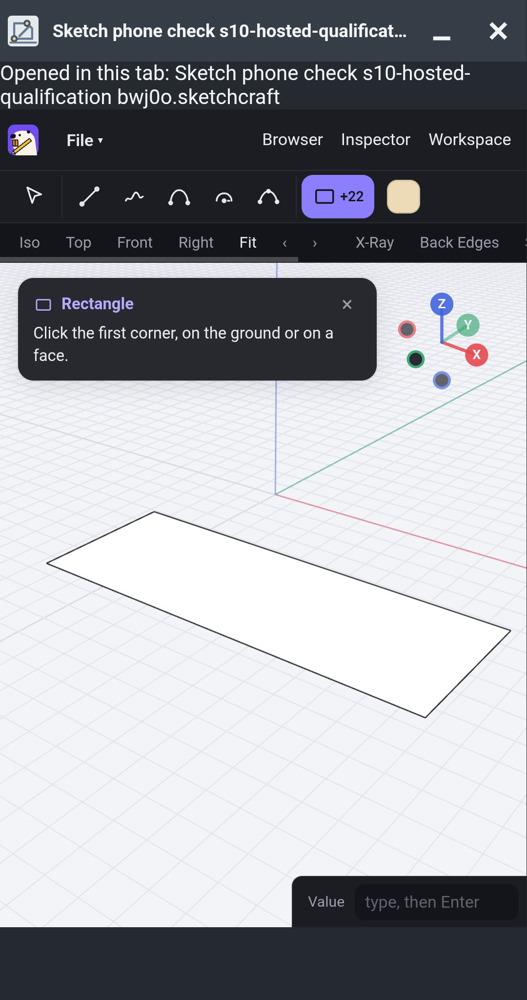

# SketchCraft in WebOS

Open **CAD → SketchCraft**. The browser runs its geometry engine locally.
Guest My files belong to the current tab. Sign in to keep the project across
browser sessions.

## Galaxy S10+ workflow

Tested in Chrome 158.0.8127.92 at 411 CSS pixels in portrait.

1. Choose Rectangle and tap two opposite corners. The saved model should
   contain four vertices, four edges and one face.
2. Choose **File → Save As**, pick a folder in My files, and enter a bare name.
   The filename prompt suggests `Untitled.sketchcraft` and supplies the suffix
   if omitted. The Android keyboard leaves both the field and Save reachable.
3. Close SketchCraft and open the file in My files. The complete face is
   visible. **Fit** frames it within the available width and height.
4. Open the tool overflow, find **Push / Pull** and tap the face. Enter
   `200mm` in the value field. The saved model now has eight vertices and
   six faces.
5. Choose **File → Save** to update the current project. The hosted guest
   test read the second revision from My files and verified the geometry.

6. Use **File → Export → Download STL (mm)…**. Chrome saves the STL in its
   Downloads location with the model name. The editable project remains in
   My files. The test STL has 12 triangles, the same bounds as the project,
   and a height of 200 mm. An empty project displays a message instead of
   downloading an empty file.

## Workflow coverage

| Workflow | S10+ portrait | Desktop Chromium |
|---|---|---|
| Draw a rectangular face | Passed | Passed |
| Extrude a face to a typed distance | Passed | Passed |
| Undo and redo a modeling edit | Open | Passed |
| Fit, orient and change the projection | Fit passed | Passed |
| Save the first editable project | Passed | Passed |
| Save a later revision in place | Passed | Passed |
| Save an independent copy | Open | Passed |
| Cancel Save As and retain the document | Open | Passed |
| Open a saved project through the app picker | Open | Passed |
| Open an editable project through My files | Passed | Passed |
| Reopen server-backed work from a fresh sign-in | Open | Passed |
| Organize faces into a group or component | Open | Grouped six faces and saved |
| Apply materials and appearance styles | Open | Swatch and Blueprint theme passed |
| Lay out a drawing sheet and add a model view | Open | Saved an A3 sheet with a 1:50 plan view |
| Open external CAD or SketchUp files | Standalone | Standalone |
| Export a model or drawing | STL passed | STL passed |
| Run a desktop plugin | Standalone | Standalone |
| Restore a native backup | Standalone | Standalone |

The core portrait workflow passed six of eighteen rows plus Fit. Desktop
Chromium 158.0.8127.36 passed fifteen of eighteen. Desktop-only formats
such as OBJ, DXF and PDF still require standalone SketchCraft.
The emulated 820 × 1050 touch tablet passed rectangle, editable reopen,
Push / Pull, and save in place and kept the app bar available.

The browser UI builds from `app/` with `npm ci` then
`npm run build -- --mode webos --base ./`. The Rust 1.99.1 browser engine reuses the
standalone binary STL encoder and limits browser output to 32 MiB. Build the
complete package with `web/package.sh` using wasm-bindgen 0.2.130. All 282
app tests and 94 native modeling tests passed. The hosted viewer is
`b3d7562df2dc94f19abbd24d0c001d9fd04592b628ed847dfd16eb7c820ae9e6` with SketchCraft source `30c85a691c54f6906a947d36e130fb7d3ea8e89e`.
