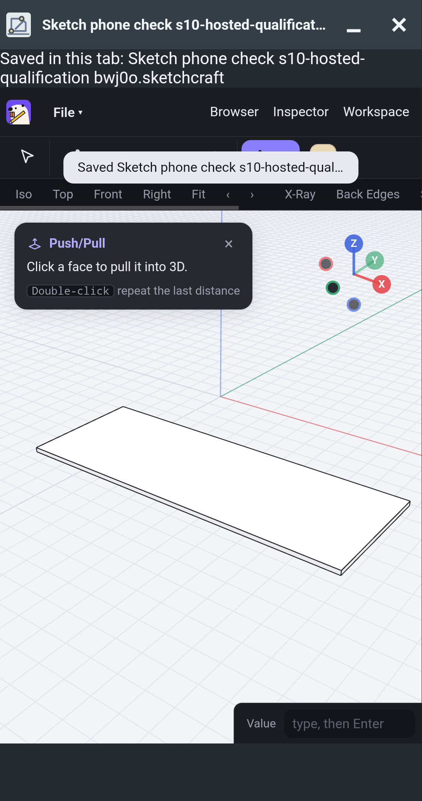

# SketchCraft in WebOS

Open **CAD → SketchCraft**. The browser runs its geometry engine locally.
Guest My files belong to the current tab. Sign in to keep the project across
browser sessions.

## Galaxy S10+ workflow

Tested in Chrome 158.0.8127.92 at 411 CSS pixels in portrait.

1. Choose Rectangle and tap two opposite corners. The saved model should
   contain four vertices, four edges and one face.
2. Choose **File → Save As**, pick a folder in My files, and enter a bare name.
   The filename prompt suggests `Untitled.sketchcraft` and supplies the suffix
   if omitted. The Android keyboard leaves both the field and Save reachable.
3. Close SketchCraft and open the file in My files. The complete face is
   visible. **Fit** frames it within the available width and height.
4. Open the tool overflow, find **Push / Pull** and tap the face. Enter
   `200mm` in the value field. The saved model now has eight vertices and
   six faces.
5. Choose **File → Save** to update the current project. The hosted guest
   test read the second revision from My files and verified the geometry.

## Workflow coverage

| Workflow | S10+ portrait | Desktop Chromium |
|---|---|---|
| Draw a rectangular face | Passed | Passed |
| Extrude a face to a typed distance | Passed | Passed |
| Undo and redo a modeling edit | Open | Passed |
| Fit, orient and change the projection | Fit passed | Passed |
| Save the first editable project | Passed | Passed |
| Save a later revision in place | Passed | Passed |
| Save an independent copy | Open | Passed |
| Cancel Save As and retain the document | Open | Passed |
| Open a saved project through the app picker | Open | Passed |
| Open an editable project through My files | Passed | Passed |
| Reopen server-backed work from a fresh sign-in | Open | Passed |
| Make and edit groups or components | Open | Open |
| Apply materials and appearance styles | Open | Open |
| Lay out a drawing sheet and add a model view | Open | Open |
| Open external CAD or SketchUp files | Standalone | Standalone |
| Export model or drawing formats | Standalone | Standalone |
| Run a desktop plugin | Standalone | Standalone |
| Restore a native backup | Standalone | Standalone |

The core portrait workflow passed five of the eighteen rows plus Fit. Desktop
Chromium 158.0.8127.36 passed eleven. Desktop parity remains in progress.
The emulated 820 × 1050 touch tablet passed rectangle, editable reopen,
Push / Pull, and save in place and kept the app bar available.

The browser UI builds from `app/` with `npm ci` then
`npm run build -- --mode webos --base ./`. The camera fix uses the existing
verified Rust/WASM geometry package. Run `npm run check` and `npm test` in
`app/` for the app-level tests. The hosted viewer is
`bdeb4cb0b66ceba720067066f84dc38af97ed612290e969a42ed2d8921aaa426` with
SketchCraft source `b752e9d03967bca49cfe9417297942f6b9a101bf`.
